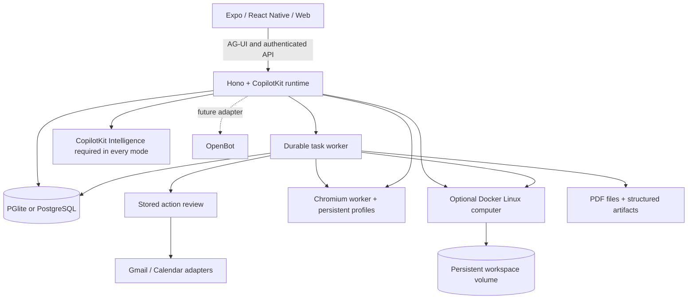

  <div align="center">

# OpenMuse

**A personal agent with a browser, terminal, files, and work that keeps going. Compatible with any agent harness.**

Ask for an outcome. Follow the plan, review actions, and come back to the result.
Built with CopilotKit React Native for iOS, Android, and web.

[Quick start](#quick-start) · [Demo](#demo) · [Features](#features) · [Architecture](#architecture) · [Docs](docs/README.md) · [Contributing](CONTRIBUTING.md)

[](https://github.com/CopilotKit/OpenMuse/actions/workflows/ci.yml)
[](LICENSE)

Clone this template and customize it however you want.

**[Building on OpenMuse? Meet with the CopilotKit team →](https://www.copilotkit.ai/openmuse)**

[](assets/demos/2026-09-16/mobile.mp4)

**[Watch the mobile demo · 38 seconds](assets/demos/2026-09-16/mobile.mp4)**

[](assets/demos/2026-09-16/web.mp4)

**[Watch the web demo · 42 seconds](assets/demos/2026-09-16/web.mp4)**

</div>

> **Alpha, for self-hosting and building on.** Open-ended reasoning, live Google accounts, and CopilotKit Rich Threads require their own configuration. See [what is verified](docs/VERIFICATION.md) and the [roadmap](ROADMAP.md).

## Demo

On iPhone, ask OpenMuse to find interesting stories on Hacker News and summarize CopilotKit. On desktop, ask it to check the school-trip email, open the message, and research exhibits at Monterey Bay Aquarium. The agent shows email and browser results inline. **Take control** opens that same browser session when you need it.

The 38-second iPhone and 42-second desktop web demos show the current interface, framed in 16:9. The send arrow becomes a stop square inside the input pill while the agent replies, then switches back. Stopping keeps your draft intact. See the [recording notes](docs/DEMO.md) for the model setup and reproduction steps.

[Mobile MP4](assets/demos/2026-09-16/mobile.mp4) · [Web MP4](assets/demos/2026-09-16/web.mp4) · [Recording details and reproduction](docs/DEMO.md)

## What it is

OpenMuse is a personal-agent application with an agent computer, visible work, and rich results. It runs its own server, task worker, and browser worker. You can inspect and change the source under the MIT license.

The computer combines **persistent Chromium and an optional Linux workspace**. The agent can browse public pages, run commands in its own container, work with files, and move PDFs between the computer and the app. You can open its browser or terminal and continue the work. Graphical desktops and autonomous checkout remain future work.

## Features

| Surface | What runs in this alpha |
| --- | --- |
| **Chat** | CopilotKit headless chat with streamed AG-UI events, mailbox search and reading, send/stop in one input pill, a visible follow-up queue, retained drafts, delegated tasks, and inline email, browser, PDF, plan, and finance cards. |
| **Agent computer** | Persistent browser profiles and takeover console; optional isolated Linux terminal, saved command receipts, editable workspace files, and PDF transfer. |
| **Activity** | Durable task plans, progress, input requests, pause/resume/cancel/retry, approvals, and saved receipts. SQL leases recover interrupted work. |
| **Ideas** | Suggestions with source evidence; edit, accept, or dismiss. Sent replies and completed matching work are excluded. |
| **Goals & Tracking** | Goals and milestones; recurring public-page checks for changes, text availability, or USD price thresholds, with deduplicated alerts and failure backoff. |
| **Documents** | Email attachment → PDF → requested form values → filled copy → reviewed reply → receipt. Native/web PDF viewing, paging, zoom, supported fields, and sharing. |
| **Finance** | Import transaction CSV to create a spending summary with categories, transactions, and a savings-goal action. |
| **Gmail & Calendar** | Google OAuth adapters, complete mail threads, drafts/attachments, calendar discovery, and reviewed event creation/update/deletion. Live credentials required. |
| **Personal context** | Editable name, tone, avatar, and memories. Background-update preferences and durable in-app notifications. |
| **Rich Threads** | CopilotKit Intelligence persistence in every mode, with a stable main conversation, side chats, renaming, archiving, restoring, and replay. A server-only project key is required. |

The [feature inventory](docs/FEATURES.md) describes implemented capabilities and planned extensions. Health/bank/social connectors, device push, voice, generated executable tools, and automatic reservations/payments are on the [roadmap](ROADMAP.md).

## Quick start

**Requirements:** Node 24 LTS, pnpm 11.19.0, and a CopilotKit Intelligence project key. The local sample app needs no model, Google account, or Docker.

```sh
git clone https://github.com/CopilotKit/OpenMuse.git openmuse
cd openmuse
pnpm install --frozen-lockfile
cp .env.example .env
npx copilotkit@latest login
npx copilotkit@latest project select
# Set CPK_INTELLIGENCE_API_KEY in .env to the generated server-only project key.
pnpm dev
```

In another terminal:

```sh
pnpm dev:web
```

Open [localhost:8081](http://localhost:8081). The API runs at [localhost:8787/api/health](http://localhost:8787/api/health).

### Try it

1. In Chat, send **“Complete the permission slip”**. Open the task, supply fictional form values, inspect the saved PDF, and review the prepared reply. This writes only to the local mailbox.
2. In **Goals → Track**, create a built-in availability watch, then change the built-in test page to trigger an alert.
3. In **Menu → Delegate task → Finance**, use **Try example transactions** to create an interactive spending tracker.
4. Start the [browser worker](#browser-worker) and configure a model, then ask **“Check out Hacker News for cool stuff”** or **“Summarize copilotkit.ai”**. Follow the browser inline and use **Take control** to open its session. For a model-free version of this flow, follow the [AI Mock demo setup](docs/DEMO.md#run-the-agent-browser-demo).

For iOS or Android, use `pnpm --dir apps/mobile ios` or `pnpm --dir apps/mobile android`. Xcode or Android tooling is required. The PDF reader needs an Expo development build; use [native setup](apps/mobile/README.md).

## Configure the agent and Google

Copy the commented settings in [.env.example](.env.example) into your private `.env`:

1. Set `AGENT_BACKEND=model`, `MODEL=provider/model-id`, and the matching provider key. CopilotKit supports the configured OpenAI, Anthropic or Google provider. Fictional data can still be used with a real model. Provider keys stay on the server. The chat runs on `WORKER_MODEL` (the quick model) when it is set, to keep messages cheap; set `CHAT_MODEL` to put it on another model, such as `MODEL`.
2. Create or select a CopilotKit Intelligence project with `npx copilotkit@latest login` and `npx copilotkit@latest project select`. Keep the generated `CPK_INTELLIGENCE_API_KEY` on the server.
3. For personal mail/calendar, set `WORKSPACE_MODE=live`, the generated `CPK_INTELLIGENCE_API_KEY`, a random `OPENMUSE_ACCESS_KEY` of at least 24 characters, and `TOKEN_ENCRYPTION_KEY` containing 32 random bytes encoded as base64. Restart the API.
4. Configure a Google OAuth web client with Gmail and Calendar APIs enabled. Set `GOOGLE_CLIENT_ID` and `GOOGLE_CLIENT_SECRET`; register `${PUBLIC_API_URL}/api/google/callback` as its redirect URI. Configure consent/test-user access in your Google project.
5. Open **Apps → Gmail** (or **Google Calendar**), connect read access, and grant write access when needed. Every send or calendar change still requires its own stored review. Changing/disconnecting the account invalidates pending connection-bound work.

Google credentials are encrypted at rest. File URLs and browser consoles use short-lived signatures. This deployment uses one owner protected by a shared access key; it is not a multi-tenant authentication system. Use HTTPS and restricted network access for a remote host. Keep the default local-data mode on loopback.

## Browser worker

Set `BROWSER_WORKER_URL=http://127.0.0.1:8790` and a random `WORKER_TOKEN` of at least 32 characters in `.env`.

```sh
pnpm --dir apps/worker exec playwright install chromium
pnpm dev:browser
```

Or use `docker compose --env-file .env -f infra/compose.yaml up --build -d`. The same token must reach the API and worker. Sessions have persistent Chromium profiles; the app can open a live screenshot console and import PDF downloads. Agent tools can read public pages and hand interactive work to the person. [Worker setup and boundaries](apps/worker/README.md).

## Live voice: OpenAI's and our own, side by side

Talking live runs on one of two voices, chosen per person:

- **OpenAI** (`gpt-live-1`): the browser connects to OpenAI over WebRTC; the api makes the session (`OPENAI_VOICE_API_KEY`) and listens in on a sideband for transcripts, minutes and hand-offs.
- **Our own** (`apps/voice`): Pipecat with Soniox (listening), Claude Haiku 4.5 with prompt caching (thinking), and Inworld TTS-2 Flash or Speechify Simba 3.2 (speaking), with Silero plus the smart-turn model deciding when someone has finished and stopping the voice the moment they talk over it. The voice service speaks the same small protocol as OpenAI's live voice, so the api's call handling is shared: hand-offs to the chat agent ("one sec"), cards on the call screen, approving by voice, urgent alerts, saved calls and the call screen itself are the same. The browser's audio reaches the service through Cloudflare's TURN relay, because Railway takes no UDP from outside; the service has no public address.

**Set it up (Railway).**

1. In Cloudflare, open **Realtime → TURN Server → Create** and keep its key ID and API token.
2. Add a service from this repository with root directory `apps/voice` (it builds `apps/voice/Dockerfile`). Give it the variables in `apps/voice/.env.example`: the same `VOICE_INTERNAL_TOKEN` as the api, `SONIOX_API_KEY`, `ANTHROPIC_API_KEY` (a reference to the api's: `${{api.ANTHROPIC_API_KEY}}`), `VOICE_TTS=inworld` with `INWORLD_API_KEY` (or `speechify` with `SPEECHIFY_API_KEY`), and `VOICE_WORKERS` (about one per CPU core). It needs no public domain.
3. On the api service add `VOICE_SERVICE_URL=http://<voice service name>.railway.internal:8080`, `VOICE_INTERNAL_TOKEN`, `CLOUDFLARE_TURN_KEY_ID` and `CLOUDFLARE_TURN_API_TOKEN`. Leave `VOICE_PROVIDER` unset (OpenAI stays everyone's default).
4. Choose **Deploy** on Railway's banner for both services (variables do nothing until then). The api's log then says `Our own voice on (…)` and `Voice service reachable`.

**Switch who uses which.** The admin's **People** card (Apps › Account › People) has **Live talk voice**: *Try the new voice* for yourself, and for each person. `VOICE_PROVIDER=pipecat` makes ours everyone's default; anyone set to OpenAI stays there. The app needs no change: it asks the api which voice to use.

**Limits.** On our own voice each person gets `VOICE_MONTHLY_MINUTES` a month (200 by default). When 10 or fewer are left the voice says so in its hello; under 30 seconds left a call can't start, a running call is warned 20 seconds before it ends, and Talk goes to the chat until the 1st (in the person's time zone). `0` means no limit. A quiet call hangs up after `VOICE_PIPECAT_IDLE_SECONDS` (30); OpenAI's keep `VOICE_IDLE_SECONDS` (90).

**Run a side-by-side test.** Put yourself (and a few testers) on the new voice, make the same kinds of calls on both voices, then tap **Compare the voices** on the People card for the summary. The full report, with each call's turn times, comes from the api (admin only). `$TOKEN` is your sign-in token: in the app on the web, open the browser's developer tools › Application › Local Storage and copy `openmuse.session`. Keep it private; anyone with it is signed in as you.

```sh
curl -H "Authorization: Bearer $TOKEN" "$PUBLIC_API_URL/api/voice/compare?days=7"
```

For each voice it gives the number of calls and minutes, turn times (median, 90th percentile and average, measured in the app the same way for both: from the end of the person's words to the first sound back; ours also has the server's own measure), and the cost of a minute broken into its parts (OpenAI's flat rate; our listening, thinking and speaking). Hand-offs to the chat agent cost the same on both and are left out. Each call's transcript is in the chat, as before.

**Capacity.** One worker process carries about four calls (WebRTC's audio is handled in Python by aiortc, at roughly 0.4 of a CPU core a call); the service's front sends each new call to the least busy worker. For 50 calls at once, give the service about 24 vCPU and 8 GB with `VOICE_WORKERS=12`. Beyond what one Railway service can hold, run a second voice service and split people between them, or move the transport to a WebRTC media server (Pipecat's Daily or LiveKit transports) so the audio leaves Python.

**Run it locally (no keys).** Stand-ins replace Soniox and the voice (`VOICE_STT=fake VOICE_TTS=fake`) and a mock of Anthropic's API replaces Claude:

```sh
cd apps/voice && python -m venv .venv && .venv/bin/pip install -r requirements.txt
.venv/bin/python tests/mock_anthropic.py 8799 &
HOST=127.0.0.1 PORT=8085 VOICE_INTERNAL_TOKEN=dev VOICE_STT=fake VOICE_TTS=fake \
  ANTHROPIC_BASE_URL=http://127.0.0.1:8799 .venv/bin/python -m openmuse_voice &
.venv/bin/python tests/call_test.py --url http://127.0.0.1:8085 --token dev --audio question.wav --calls 2
```

Then point the api at it (`VOICE_SERVICE_URL=http://127.0.0.1:8085 VOICE_INTERNAL_TOKEN=dev VOICE_PROVIDER=pipecat`). The test caller plays a recorded question as a browser would and reports each turn's time and the service's CPU.

**A phone line later.** `run_call` in `apps/voice/openmuse_voice/pipeline.py` takes any Pipecat transport. A Twilio dial-in is a new route that accepts Twilio's media stream with Pipecat's `FastAPIWebsocketTransport` and Twilio serializer, then runs the same pipeline and `Call`.

**Retire OpenAI's voice** once the comparison says so:

1. Set `VOICE_PROVIDER=pipecat` on the api and Deploy; in People, tap *Try the new voice* for anyone still on OpenAI.
2. After a while with no OpenAI calls (the comparison shows none), remove `OPENAI_VOICE_API_KEY`.
3. In code: drop the OpenAI `LiveVoice` instance in `apps/server/src/app.ts` (keep the class; it drives our voice), make `voiceFor` and `liveVoiceOf` always return ours, drop the `provider === "openai"` branches in `voice-pipecat.ts`, and remove the OpenAI path in `apps/mobile/src/live-voice.ts` (the `ours` checks).

## Recording meetings

People record a meeting in the room from Home, the chat's **+** menu, Files › Meetings, or by saying "Record a meeting". The web app records the microphone in 30-second pieces and uploads them as it goes (a phone lock pauses it; it carries on as a new part). When it stops, the api sends the audio to Soniox's async API (`stt-async-v5`, with speakers), then the "simple" model writes a summary, decisions and action items. The words stay until the meeting is deleted; the audio is kept 30 days. The chat, calls and background jobs can list, read and search meetings.

On Railway, add `SONIOX_API_KEY` to the api service (a reference to the voice service's works: `${{voice.SONIOX_API_KEY}}`) and choose Deploy. `MEETING_MONTHLY_HOURS` (default 10) limits each person; usage shows as "Recorded meetings". Without the key, the Record buttons say it isn't set up.

## Persistence and operation

### Linux terminal and workspace

Build the computer image, enable it on the API, then open **Computer → Terminal → Start computer**:

```sh
docker build -t openmuse-computer:local apps/computer
COMPUTER_ENABLED=true pnpm dev
```

The API needs access to the Docker CLI and engine. Commands run in a nonroot container with no host-directory mounts or credentials. A named `/workspace` volume retains files when stopped. Terminal networking is disabled; public web access uses the browser worker. Commands have a 30-second limit and saved output/exit receipts. **Files** supports folders, text editing, and PDF transfer to/from Documents. This is a Linux container, not a full operating-system VM. [Setup, Colima option, and boundaries](docs/COMPUTER.md).

### Application storage

By default, embedded PGlite, documents and the signing key live in `.openmuse/`; browser profiles live in `.openmuse/browser-profiles/`. Keep that directory private and back it up. The API hosts the task worker. The host must remain running for background work.

For a separate task worker, configure the same `DATABASE_URL`, secrets and shared `DATA_DIR` for both processes, then set `TASK_WORKER_ENABLED=false` on the API and run `pnpm dev:worker`. PGlite cannot be opened by separate processes. Production commands are `pnpm build:server`, `pnpm start` and `pnpm start:worker`. Run one API instance; task workers coordinate through SQL leases.

No hidden retry occurs after an uncertain external write. Review its provider outcome before creating a replacement. Pausing/cancelling prevents subsequent task steps; an already approved in-flight provider request may finish.

## CopilotKit Rich Threads

Every deployment requires `CPK_INTELLIGENCE_API_KEY` on the API server for CopilotKit Intelligence conversation persistence and replay. Create or select a project with `npx copilotkit@latest login` and `npx copilotkit@latest project select`, set the generated server-only key, and restart the API. The native menu uses `useThreads`; rich tool results link back to saved tasks, documents, and browser sessions.

Intelligence is a separate service and is not included in this repository's MIT license. No project key is shipped. [Configuration and validation boundaries](docs/RICH-THREADS.md).

## Architecture



| Directory | Purpose |
| --- | --- |
| `apps/mobile` | Shared iOS, Android, and web UI with CopilotKit headless hooks. |
| `apps/server` | API, CopilotKit runtime, identity boundary, task engine, reviews, files, and persistence. |
| `apps/worker` | Token-protected Playwright browser service with persistent profiles. |
| `apps/computer` | Nonroot Linux image, bounded filesystem helper, and real container verification. |
| `packages/domain` | Shared types and request validation. |
| `packages/integrations` | Google and browser protocol adapters. |
| `packages/backends` | Optional OpenBot HTTP adapter and its identity boundary. |
| `tests` | Workflow, runtime, persistence, provider-contract, and authorization tests. |

### OpenBot compatibility

OpenMuse's native client and personal-agent workflows are independent of OpenBot. The disabled OpenBot adapter is pinned and contract-tested against upstream interfaces. Live user/session bridging, routine mapping, and computer backend wiring remain future work. OpenBot's Intelligence runtime is not a raw AG-UI endpoint. [Integration contract](docs/OPENBOT-INTEGRATION.md).

## Development

```sh
pnpm lint
pnpm typecheck
pnpm test
pnpm build:server
pnpm build:web
pnpm build:ios
pnpm build:android
pnpm --dir apps/worker typecheck
pnpm test:browser
pnpm test:computer
```

Platform build scripts export JavaScript/Hermes bundles; they do not produce signed app binaries. Browser checks require installed Chromium and public fixture access. CI also exercises the browser and Linux computer containers. See [contribution guidance](CONTRIBUTING.md) and [verification results](docs/VERIFICATION.md).

## Contributing and license

Issues and pull requests are welcome. Start with [CONTRIBUTING.md](CONTRIBUTING.md), [ROADMAP.md](ROADMAP.md), and the [security policy](SECURITY.md).

MIT licensed. Built by CopilotKit. Its original interface and fictional assets are included. Website, email, and document content supplies evidence, not permission to act.
